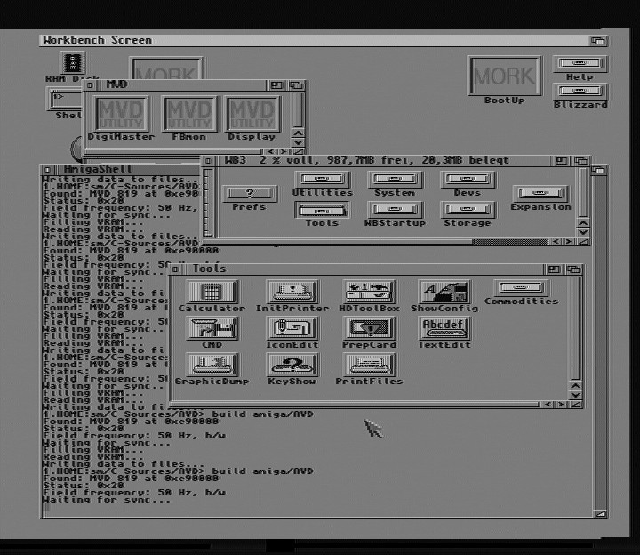

# Amiga Video Digitizer

## MVD 819

The [Masoboshi](https://amiga.resource.cx/manuf/masoboshi) [MVD
819](https://amiga.resource.cx/exp/mvd819) has a driver for AmigaOS
available via the mvd.library; however, a driver for Linux is currently
missing. Developing one would require integrating the following components:

- TDA8708T video A/D converter
- S-DMS SAA 9051 video decoder
- I²C-based control interface
- SAA 9057A clock signal generator
- TMS4C1050-40N video memory

The Philips SAA 9051 is controlled via I²C and digitizes analog signals from
two sources, storing the data into memory. From a software perspective, the
SAA 9051 must be configured via I²C, and its video status can be read out.
The VRAM is accessed via specific I/O ports. The SAA 9051 is addressed using
the slave address 0x8a; the least significant bit determines whether the
operation is a read (0) or a write (1). This is followed by a sub-address
used to access individual registers. It is possible to transmit a sequence
of bytes, with register numbers incrementing automatically.

I²C control is handled via I/O addresses relative to the base address
assigned by the AutoConfig system:

| Rel. I/O address MVD | Rel. IO address VLab | Bit | Function |
| -------: | -------: | :-------: | ------- |
| 0x4f01|0x2901|0|SDA (Byte Write)|
| 0x4f01|0x2901|1|CLK (Byte Write)|
| 0x4d01|0x2b01|0|SDA (Byte Read)|

The VRAM is a TMS4C1050-40N, which is suitable for use as video RAM. It has
the following pinout/mapping:

| Rel. I/O address MVD | Rel. IO address VLab | Function |
| -------: | -------: | ------- |
| 0x0080|0x0000|Read Y, one long word: four Y values |
| 0x0181|0x0401|Read UV, one byte: alternating U and V values |
| 0x4300|0x2280|Reset Read Address (Word Read) |
| 0x4701|0x2101|Enable Write (Bit 0, Byte Write) |
| 0x4000|0x2200|Set RSTW, Reset Write Address on (Word Read) |
| 0x4100|0x2080|Clear RSTW, Reset Write Address off (Word Read) |

The process of reading from the memory requires further investigation. The
current AmigaOS driver reads four Y values ​​as a single long
word, and UV values ​​byte-by-byte—alternating between the high
nibbles and the low nibbles. It is likely that the UV data can be read in a
single operation using a long word, though the nibbles would still need to
be rearranged accordingly. The memory mapping follows a 4:1:1 YUV format,
meaning that every four Y values ​​share a single U and V value.

Vertical and Horizontal Blank signals also hold special significance and can
be accessed via an additional IO register:

| Rel. I/O address MVD | Rel. IO address VLab | Bit | Function |
| -------: | -------: | :------: | ------- |
| 0x4501|0x2301|0|VBlank (Byte Read)|
| 0x4501|0x2301|1|HBlank (Byte Read)|

## Test Software

For testing purposes, this GitHub repository has been set up that uses C++
to interface with the hardware. It simply initializes the SAA 9051. In case
there is a valid video signal available it catches a complete frame, or two
fields. The data is stored simply in to raw data files:
- frame_y.dat, which contains the complete raw Y channel data. Note that the value domain is from [0..127].
- frame_uv.dat, which contains the complete raw UV channels data. The data contains alternating U and V signed bytes.

If you plan to save the data as JPEG, use the
[AVD-Viewer](https://github.com/stmork/avd-viewer) software, which can read
both raw data files. This way is convenient since the YUV color conversion
is done by any suitable viewer.



## Build
You can build this software for AmigaOS as well as for Linux. To cross
compile on Linux for AmigaOS you need a runtime environment from
[AmigaPort](https://github.com/AmigaPorts) for the [m68k C/C++
Compiler](https://github.com/AmigaPorts/m68k-amigaos-gcc) To compile you can
use the following commands:
```
cmake -B build -DCMAKE_TOOLCHAIN_FILE=toolchain-m68k-amigaos.cmake
make -C build
```

The executing software uses the expansion.library to find any support video
digitizer board. Note that only the videodevicefactory.cc file contains
Amiga specific code! The Linux variant emulates a MVD 819 without providing
any useful data. For compiling simply use the following commands as usual
for CMake:
```
cmake -B build
make -C build
```
